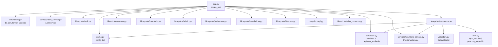

# Diseño Técnico: Consolidación de Código

## Visión General

La aplicación Flask de gestión de préstamos y reservas universitarias tiene dos pares de archivos duplicados:

- `app.py` (versión activa) / `app_improved.py` (versión mejorada con factory function)
- `blueprints/prestamos.py` (versión activa) / `blueprints/prestamos_mejorado.py` (versión mejorada con validaciones y auditoría)

El objetivo es fusionar cada par en un único archivo que tome lo mejor de ambas versiones, sin romper las plantillas existentes ni la funcionalidad actual.

---

## Arquitectura

### Estado actual

```
app.py  ←── activo, sin factory function, context processor simple (session dict)
app_improved.py  ←── inactivo, tiene create_app(), inject_module_access con DB, AlertService

blueprints/prestamos.py  ←── activo, importa extraer_numero_corto desde services, sin obtener_disponibles
blueprints/prestamos_mejorado.py  ←── inactivo, tiene obtener_disponibles(), registrar_auditoria con usuario_*
```

### Estado objetivo

```
app.py  ←── único, con create_app(), inject_module_access con DB, AlertService, filtro por sede
blueprints/prestamos.py  ←── único, con obtener_disponibles(), extraer_numero_corto local,
                               id_prestamo en equipo_info, validación con DataValidator,
                               registrar_auditoria con usuario_documento/usuario_nombre
```

### Diagrama de dependencias (post-consolidación)



---

## Componentes e Interfaces

### `app.py` consolidado

**Función `create_app(config_name=None)`**

```python
def create_app(config_name=None) -> Flask
```

- Lee `FLASK_CONFIG` del entorno si `config_name` es `None`.
- Inicializa `db`, `csrf`, `limiter`, `socketio` desde `extensions`.
- Registra los 10 blueprints: `auth_bp`, `estadisticas_bp`, `api_bp`, `prestamos_bp`, `reservas_bp`, `inventario_bp`, `admin_bp`, `profesores_bp`, `bitacora_bp`, `salas_computo_bp`.
- Registra el context processor `inject_module_access`.
- Registra la ruta `GET /` (`index`).
- Retorna la instancia `app`.

**Context processor `inject_module_access`**

Lógica de tres ramas:

| Condición | Resultado |
|---|---|
| `rol` es `admin` o `superadmin` | Todos los módulos `True`, sin consultar DB |
| `usuario` no está en sesión | Todos los módulos `False`, sin consultar DB |
| Usuario autenticado con rol normal | Consulta `UserPermission` y construye el dict |

Módulos cubiertos: `prestamos`, `reservas`, `inventario`, `profesores`, `estadisticas`, `bitacora`, `salas_computo`.

**Ruta `GET /` (`index`)**

- Acepta parámetro `periodo` (`dia` | `semana` | `mes`).
- Aplica filtro `sede_id` si el rol no es `admin`/`superadmin`.
- Calcula `stats`, `top_equipo`, `top_profesor`.
- Llama a `AlertService.check_overdue_prestamos` y `AlertService.check_upcoming_reservas` dentro de un bloque `try/except` que solo registra en log si falla.
- Renderiza `index.html` con `stats`, `top_equipo`, `top_profesor`.
- En caso de excepción general, renderiza con valores `None` y flash de advertencia.

**Bloque `if __name__ == '__main__'`**

```python
if __name__ == '__main__':
    app = create_app()
    socketio.run(app, debug=True, host='0.0.0.0', port=5000)
```

**Rutas que NO deben existir en `app.py`**

Las siguientes rutas del `app.py` actual deben eliminarse porque ya están en los blueprints:

- `/prestamos_equipos` → `prestamos.prestamos_equipos`
- `/nuevo_prestamo` → `prestamos.nuevo_prestamo`
- `/devolver_prestamo/<id>` → `prestamos.devolver_prestamo`
- `/prestamos/exportar/<formato>` → `prestamos.exportar_prestamos_activos`

**Funciones que NO deben existir en `app.py`**

Ya están en `services/prestamo_service.py`:

- `calcular_jornada_desde_hora`
- `calcular_jornadas_completas`
- `obtener_jornadas_grupo_prestamo`
- `calcular_horas_academicas`

---

### `blueprints/prestamos.py` consolidado

**Función `extraer_numero_corto(numero_inventario)`** — definida localmente

```python
def extraer_numero_corto(numero_inventario: str) -> str
```

Extrae los dígitos finales del número de inventario. Lógica:
1. Si contiene `-`, retorna la última parte tras el split.
2. Si coincide con `r'(\d+)$'`, retorna los dígitos finales.
3. Si no coincide, retorna el valor tal cual.
4. Si es `None` o vacío, retorna `'--'`.

**Función `obtener_disponibles(query_inv)`**

```python
def obtener_disponibles(query_inv: BaseQuery) -> dict
```

Recibe una query base de `Inventario` (ya filtrada por sede si aplica) y retorna:

```python
{
    'portatiles': int,
    'cargadores': int,
    'hdmi': int,
    'controles': int,
    'teclados': int
}
```

Cada conteo filtra `estado == 'Disponible'` y el nombre del ítem con `ilike`.

**Función `agrupar_prestamos(prestamos_lista)`**

Igual que la versión actual, pero cada `equipo_info` **debe incluir** `id_prestamo`:

```python
equipo_info = {
    'id_prestamo': prestamo.id_prestamo,  # ← requerido para edición individual
    'item': prestamo.equipo_prestado,
    'numero': prestamo.numero_inventario_equipo,
    'numero_corto': extraer_numero_corto(prestamo.numero_inventario_equipo)
}
```

**Rutas expuestas**

| Método | URL | Función | Permiso |
|---|---|---|---|
| GET | `/prestamos/` | `prestamos_equipos` | `ver` |
| POST | `/prestamos/nuevo` | `nuevo_prestamo` | `crear` |
| POST | `/prestamos/devolver/<id>` | `devolver_prestamo` | `editar` |
| POST | `/prestamos/renovar/<id_grupo>` | `renovar_prestamo` | `editar` |
| GET | `/prestamos/detalles/<id_grupo>` | `detalles_prestamo` | `ver` |
| GET, PUT | `/prestamos/editar/<id_prestamo>` | `editar_prestamo` | `editar` |
| GET | `/prestamos/buscar` | `buscar_prestamos_api` | `ver` |
| GET | `/prestamos/exportar/<formato>` | `exportar_prestamos_activos` | `ver` |
| GET | `/prestamos/historial` | `prestamos_historial` | `ver` |
| GET | `/prestamos/historial/exportar` | `exportar_historial_prestamos` | `ver` |
| GET | `/prestamos/buscar-equipos` | `buscar_equipos` | `ver` |

**Validación en `PUT /prestamos/editar/<id_prestamo>`**

Usa `DataValidator` para todos los campos antes de persistir:

```python
DataValidator.validate_string_field(ubicacion, 'Ubicación', required=False, max_length=100)
DataValidator.validate_string_field(observaciones, 'Observaciones', required=False, max_length=500)
DataValidator.validate_time(hora_inicio_str)
DataValidator.validate_time(hora_fin_str)
DataValidator.validate_time_range(hora_inicio_obj, hora_fin_obj)
```

Actualización de ítems individuales (campo `items` en el body):

```python
for item_data in datos.get('items', []):
    p_id = item_data.get('id_prestamo')
    nuevo_num = item_data.get('numero_inventario')
    if p_id and nuevo_num:
        p_target = next((p for p in prestamo_grupo if p.id_prestamo == p_id), None)
        if p_target:
            p_target.numero_inventario_equipo = nuevo_num.strip()
```

Actualización masiva del grupo (campos comunes):

```python
for p_reg in prestamo_grupo:
    p_reg.ubicacion = ubicacion
    p_reg.hora_inicio = hora_inicio_obj
    p_reg.hora_fin = hora_fin_obj
    p_reg.observaciones = observaciones
```

**Llamadas a `registrar_auditoria`**

Todas las llamadas deben incluir:

```python
registrar_auditoria(
    ...,
    usuario_documento=session.get('usuario', ''),
    usuario_nombre=session.get('nombre_completo', ''),
    ...
)
```

---

## Modelos de Datos

No se modifican los modelos de base de datos. Los modelos relevantes son:

**`PrestamoEquipo`** (tabla `prestamo_equipo`)

| Campo | Tipo | Descripción |
|---|---|---|
| `id_prestamo` | Integer PK | Identificador único del registro |
| `id_grupo_prestamo` | Integer FK | Agrupa registros del mismo préstamo dividido por jornadas |
| `cedula_profesor` | String | Cédula del profesor |
| `nombre_profesor` | String | Nombre completo del profesor |
| `equipo_prestado` | String | Descripción del equipo |
| `numero_inventario_equipo` | String | Número de inventario del equipo |
| `ubicacion` | String | Salón o ubicación del préstamo |
| `fecha_prestamo` | Date | Fecha del préstamo |
| `hora_inicio` | Time | Hora de inicio |
| `hora_fin` | Time | Hora de fin prevista |
| `hora_devolucion_real` | Time | Hora real de devolución |
| `estado` | String | `Prestado` / `Devuelto` |
| `jornada` | String | `MAÑANA` / `TARDE` / `NOCHE` |
| `horas_academicas` | Float | Duración en horas |
| `auxiliar_entrega` | String | Auxiliar que entregó |
| `auxiliar_recibe` | String | Auxiliar que recibió |
| `observaciones` | String | Notas adicionales |
| `sede_id` | Integer FK | Sede del préstamo |

**`UserPermission`** (tabla `user_permission`)

| Campo | Tipo | Descripción |
|---|---|---|
| `id` | Integer PK | |
| `usuario_documento` | String | Documento del usuario |
| `modulo` | String | Nombre del módulo |
| `accion` | String | Acción permitida (`ver`, `crear`, `editar`) |

**`Inventario`** (tabla `inventario`)

| Campo | Tipo | Descripción |
|---|---|---|
| `id` | Integer PK | |
| `numero_inventario` | String | Número de inventario |
| `item` | String | Descripción del equipo |
| `estado` | String | `Disponible` / `En Préstamo` |
| `bodega_id` | Integer FK | Bodega donde está el equipo |

---

## Propiedades de Corrección

*Una propiedad es una característica o comportamiento que debe ser verdadero en todas las ejecuciones válidas del sistema — esencialmente, una declaración formal sobre lo que el sistema debe hacer. Las propiedades sirven como puente entre las especificaciones legibles por humanos y las garantías de corrección verificables por máquinas.*

### Propiedad 1: obtener_disponibles cuenta correctamente por tipo

*Para cualquier* conjunto de registros de inventario con estados y nombres variados, `obtener_disponibles(query_inv)` debe retornar exactamente el conteo de ítems con `estado == 'Disponible'` para cada categoría (portátiles, cargadores, hdmi, controles, teclados), sin contar ítems de otras categorías ni ítems no disponibles.

**Valida: Requerimiento 1.3**

---

### Propiedad 2: agrupar_prestamos incluye id_prestamo en cada equipo_info

*Para cualquier* lista de objetos `PrestamoEquipo`, el resultado de `agrupar_prestamos` debe contener el campo `id_prestamo` en cada elemento de las listas de equipos dentro de `equipos`, y ese valor debe coincidir con el `id_prestamo` del registro original.

**Valida: Requerimiento 1.4**

---

### Propiedad 3: Validación rechaza datos inválidos en editar_prestamo

*Para cualquier* combinación de datos inválidos enviados al endpoint `PUT /prestamos/editar/<id>` (ubicación mayor a 100 caracteres, observaciones mayor a 500 caracteres, hora con formato incorrecto, hora_fin anterior a hora_inicio), el sistema debe retornar HTTP 400 con un mensaje de error sin exponer detalles técnicos internos.

**Valida: Requerimientos 1.6, 1.10**

---

### Propiedad 4: Actualización masiva aplica cambios a todos los registros del grupo

*Para cualquier* grupo de préstamos identificado por `id_grupo_prestamo`, después de una operación `PUT /prestamos/editar/<id>` exitosa, todos los registros del grupo deben tener los mismos valores de `ubicacion`, `hora_inicio`, `hora_fin` y `observaciones`.

**Valida: Requerimiento 1.8**

---

### Propiedad 5: inject_module_access retorna permisos correctos según rol

*Para cualquier* estado de sesión (admin/superadmin, usuario normal, no autenticado), el context processor `inject_module_access` debe retornar `mod_access` con todos los módulos en `True` para admins, todos en `False` para no autenticados, y los permisos reales de la DB para usuarios normales.

**Valida: Requerimientos 2.3, 2.4, 2.5**

---

### Propiedad 6: Filtro por sede en el dashboard

*Para cualquier* `sede_id` en sesión de un usuario con rol no admin, las estadísticas retornadas por `GET /` deben corresponder únicamente a registros de esa sede, sin incluir registros de otras sedes.

**Valida: Requerimiento 2.6**

---

### Propiedad 7: AlertService no interrumpe el dashboard

*Para cualquier* excepción lanzada por `AlertService` (incluyendo errores de conexión a DB, timeouts, excepciones arbitrarias), la ruta `GET /` debe retornar HTTP 200 con el dashboard renderizado correctamente.

**Valida: Requerimiento 2.9**

---

### Propiedad 8: Sin rutas duplicadas en el mapa de URLs

*Para cualquier* instancia de la aplicación creada con `create_app()`, cada endpoint en `app.url_map` debe aparecer exactamente una vez, y las rutas `/prestamos_equipos`, `/nuevo_prestamo`, `/devolver_prestamo/<id>` y `/prestamos/exportar/<formato>` no deben existir como rutas directas de `app` (solo en el blueprint).

**Valida: Requerimientos 3.1, 3.3**

---

### Propiedad 9: Variables de contexto completas en plantillas de préstamos

*Para cualquier* estado de la base de datos, la ruta `GET /prestamos/` debe incluir en el contexto de la plantilla todas las variables requeridas: `prestamos_activos`, `prestamos_devueltos`, `prestamos_vencidos`, `total_activos`, `total_devueltos`, `total_vencidos`, `total_realizados`, `disponibles` y `sedes`. La ruta `GET /prestamos/historial` debe incluir `historial`. La ruta `GET /` debe incluir `stats`, `top_equipo` y `top_profesor`.

**Valida: Requerimientos 5.1, 5.2, 5.3**

---

### Propiedad 10: Resiliencia ante fallos de DB — valores vacíos en lugar de HTTP 500

*Para cualquier* fallo de base de datos en las rutas principales (`GET /prestamos/`, `GET /prestamos/historial`, `GET /`), el sistema debe retornar HTTP 200 con la plantilla renderizada usando valores vacíos o nulos, nunca HTTP 500.

**Valida: Requerimientos 1.10, 5.5**

---

## Manejo de Errores

### Estrategia general

Todas las rutas siguen el patrón:

```python
try:
    # lógica principal
    return render_template(...) / jsonify(...)
except Exception as e:
    db.session.rollback()  # solo en rutas que modifican datos
    current_app.logger.exception("Mensaje descriptivo: %s", str(e))
    # Para rutas que renderizan HTML:
    flash('Mensaje amigable sin detalles técnicos.', 'warning')
    return render_template('plantilla.html', var1=[], var2=0, ...)
    # Para rutas JSON:
    return jsonify({'success': False, 'message': 'Mensaje amigable'}), 500
```

### Reglas específicas

| Situación | Comportamiento |
|---|---|
| DB no disponible en `inject_module_access` | Retorna todos los módulos en `False` (fallback seguro) |
| `AlertService` falla en `index()` | Log de warning, continúa renderizando el dashboard |
| Validación falla en `PUT /editar` | HTTP 400 con mensaje específico del campo inválido |
| `id_prestamo` no encontrado | HTTP 404 con mensaje amigable |
| Error al exportar | Flash de error, redirect a la lista |
| Préstamo no está en estado `Prestado` al editar | HTTP 400 con mensaje explicativo |

---

## Estrategia de Pruebas

### Enfoque dual

Se requieren dos tipos de pruebas complementarias:

- **Pruebas unitarias**: verifican ejemplos concretos, casos borde y condiciones de error.
- **Pruebas de propiedades**: verifican invariantes universales sobre rangos amplios de inputs generados.

### Pruebas unitarias

Enfocadas en:

- Verificar que `create_app()` registra exactamente los 10 blueprints esperados.
- Verificar que las rutas duplicadas (`/prestamos_equipos`, etc.) no existen en `app.url_map`.
- Verificar que los archivos `app_improved.py` y `blueprints/prestamos_mejorado.py` no existen tras la consolidación.
- Verificar que `GET /` retorna HTTP 200 con `stats`, `top_equipo`, `top_profesor` en el contexto.
- Verificar que `GET /` genera flash de advertencia cuando hay préstamos vencidos.
- Verificar que `GET /` genera flash informativo cuando hay reservas próximas.
- Verificar que las variables de contexto de plantillas de préstamos están presentes.

### Pruebas de propiedades (PBT)

Librería recomendada: **`hypothesis`** (Python).

Configuración mínima: **100 iteraciones** por prueba (`settings(max_examples=100)`).

Cada prueba debe incluir un comentario con el tag:
`# Feature: code-consolidation, Property N: <texto de la propiedad>`

**Propiedad 1 — obtener_disponibles**
```python
# Feature: code-consolidation, Property 1: obtener_disponibles cuenta correctamente por tipo
@given(inventarios=st.lists(st.builds(InventarioFake, ...)))
@settings(max_examples=100)
def test_obtener_disponibles_conteo_correcto(inventarios):
    # Poblar DB con inventarios generados
    # Llamar obtener_disponibles(Inventario.query)
    # Verificar que cada conteo == len([i for i in inventarios if i.estado == 'Disponible' and tipo_match(i)])
```

**Propiedad 2 — agrupar_prestamos incluye id_prestamo**
```python
# Feature: code-consolidation, Property 2: agrupar_prestamos incluye id_prestamo en cada equipo_info
@given(prestamos=st.lists(st.builds(PrestamoFake, ...)))
@settings(max_examples=100)
def test_agrupar_prestamos_incluye_id_prestamo(prestamos):
    grupos = agrupar_prestamos(prestamos)
    for grupo in grupos:
        for categoria in grupo['equipos'].values():
            for equipo in categoria:
                assert 'id_prestamo' in equipo
```

**Propiedad 3 — Validación rechaza datos inválidos**
```python
# Feature: code-consolidation, Property 3: Validación rechaza datos inválidos en editar_prestamo
@given(datos=st.one_of(
    st.fixed_dictionaries({'ubicacion': st.text(min_size=101)}),
    st.fixed_dictionaries({'hora_inicio': st.text().filter(lambda s: not re.match(r'^\d{2}:\d{2}$', s))}),
    ...
))
@settings(max_examples=100)
def test_editar_prestamo_rechaza_datos_invalidos(client, datos):
    response = client.put(f'/prestamos/editar/1', json=datos)
    assert response.status_code == 400
    assert 'message' in response.json
    # Verificar que no hay stack traces en el mensaje
    assert 'Traceback' not in response.json['message']
    assert 'Exception' not in response.json['message']
```

**Propiedad 4 — Actualización masiva del grupo**
```python
# Feature: code-consolidation, Property 4: Actualización masiva aplica cambios a todos los registros del grupo
@given(n_registros=st.integers(min_value=1, max_value=5), datos_validos=st.builds(...))
@settings(max_examples=100)
def test_editar_aplica_a_todo_el_grupo(client, db, n_registros, datos_validos):
    grupo_id = crear_grupo_prestamo(n_registros)
    client.put(f'/prestamos/editar/{grupo_id}', json=datos_validos)
    registros = PrestamoEquipo.query.filter_by(id_grupo_prestamo=grupo_id).all()
    for r in registros:
        assert r.ubicacion == datos_validos['ubicacion']
        assert r.hora_inicio.strftime('%H:%M') == datos_validos['hora_inicio']
        assert r.hora_fin.strftime('%H:%M') == datos_validos['hora_fin']
```

**Propiedad 5 — inject_module_access**
```python
# Feature: code-consolidation, Property 5: inject_module_access retorna permisos correctos según rol
@given(rol=st.sampled_from(['admin', 'superadmin', 'auxiliar', None]))
@settings(max_examples=100)
def test_inject_module_access_por_rol(app, rol):
    with app.test_request_context():
        session['rol'] = rol
        session['usuario'] = 'doc123' if rol else None
        result = inject_module_access()
        mod_access = result['mod_access']
        if rol in ('admin', 'superadmin'):
            assert all(mod_access.values())
        elif rol is None:
            assert not any(mod_access.values())
```

**Propiedad 7 — AlertService no interrumpe el dashboard**
```python
# Feature: code-consolidation, Property 7: AlertService no interrumpe el dashboard
@given(exc=st.sampled_from([Exception, ConnectionError, ValueError, RuntimeError]))
@settings(max_examples=100)
def test_alert_service_exception_no_rompe_dashboard(client, mocker, exc):
    mocker.patch('services.alert_service.AlertService.check_overdue_prestamos', side_effect=exc())
    response = client.get('/')
    assert response.status_code == 200
```

**Propiedad 10 — Resiliencia ante fallos de DB**
```python
# Feature: code-consolidation, Property 10: Resiliencia ante fallos de DB — valores vacíos en lugar de HTTP 500
@given(ruta=st.sampled_from(['/', '/prestamos/', '/prestamos/historial']))
@settings(max_examples=100)
def test_db_failure_retorna_200(client, mocker, ruta):
    mocker.patch('extensions.db.session.query', side_effect=Exception('DB error'))
    response = client.get(ruta)
    assert response.status_code == 200
```

### Orden de ejecución recomendado

1. Pruebas unitarias de estructura (rutas registradas, archivos eliminados).
2. Pruebas de propiedades de funciones puras (`obtener_disponibles`, `agrupar_prestamos`).
3. Pruebas de propiedades de endpoints con cliente de prueba Flask.
4. Pruebas de integración end-to-end (arranque completo con `python app.py`).
