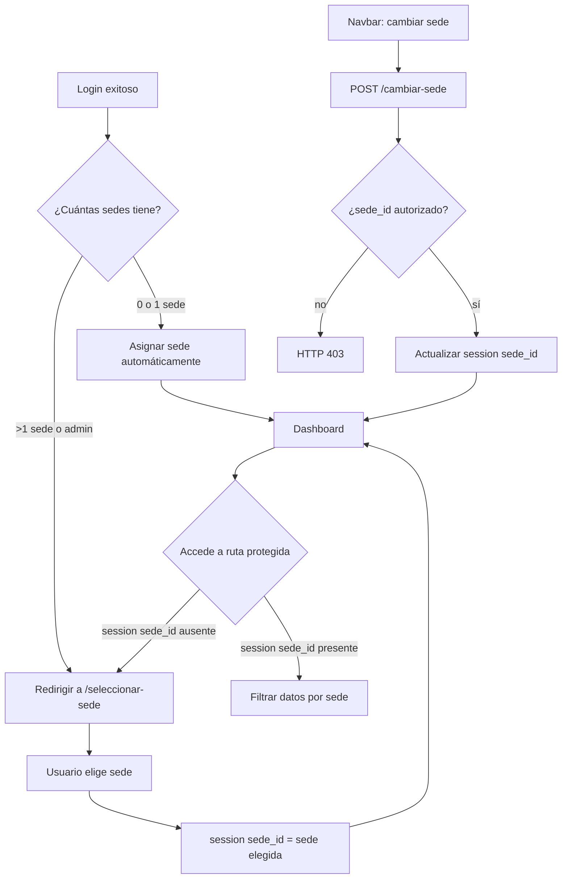
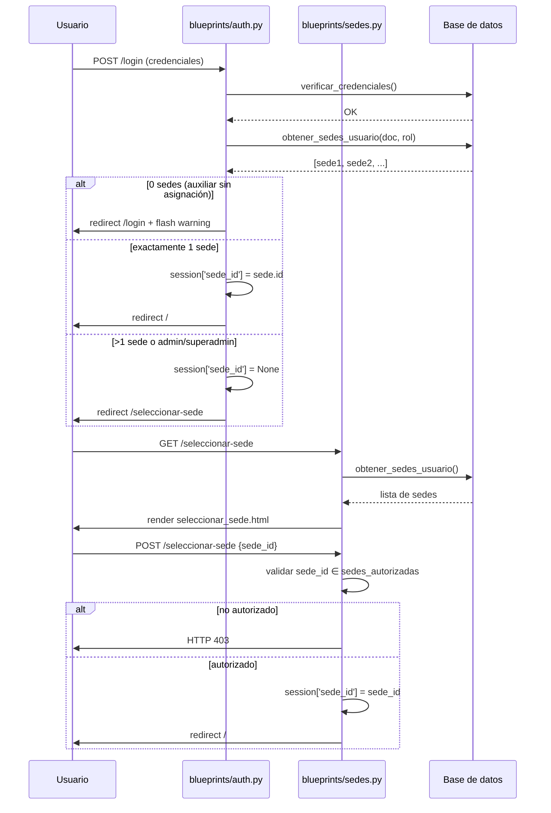

# Diseño Técnico: sede-turno-selector

## Visión General

Esta feature introduce la capacidad de que un auxiliar opere en múltiples sedes. El flujo central es:

1. Post-login: si el usuario tiene >1 sede asignada (o es admin/superadmin), se muestra una pantalla de selección de sede antes de acceder al dashboard.
2. Durante la sesión: el navbar expone un selector de sede para cambiar sin cerrar sesión.
3. Todos los módulos filtran datos por `session['sede_id']`.
4. El panel de administración permite gestionar las sedes asignadas a cada auxiliar.

La implementación se apoya en una nueva tabla `auxiliar_sedes` (relación N:M entre `auxiliares` y `sedes`) y en un nuevo decorador `sede_requerida` que protege las rutas que necesitan sede activa.

---

## Arquitectura



### Componentes afectados

| Componente | Cambio |
|---|---|
| `database.py` | Nuevo modelo `AuxiliarSede` |
| `blueprints/auth.py` | Lógica post-login para redirigir al selector |
| `auth.py` | Nuevo decorador `sede_requerida` |
| `blueprints/sedes.py` (nuevo) | Rutas `/seleccionar-sede` y `/cambiar-sede` |
| `blueprints/admin.py` | Endpoints para gestionar `auxiliar_sedes` |
| `templates/components/navbar.html` | Control de cambio de sede |
| `templates/seleccionar_sede.html` (nuevo) | Pantalla intermedia de selección |
| `blueprints/prestamos.py`, `reservas.py`, `inventario.py` | Filtros por `sede_id` |

---

## Componentes e Interfaces

### Nuevo Blueprint: `sedes_bp` (`blueprints/sedes.py`)

```
GET  /seleccionar-sede          → Muestra pantalla de selección
POST /seleccionar-sede          → Establece session['sede_id'] y redirige al dashboard
POST /cambiar-sede              → Cambia session['sede_id'] durante la sesión activa
```

### Función auxiliar: `obtener_sedes_usuario(documento, rol)`

Centraliza la lógica de qué sedes puede ver un usuario:
- `superadmin` / `admin`: todas las sedes del sistema.
- `auxiliar`: sedes en `auxiliar_sedes` donde `usuario_documento = documento`.

### Decorador: `sede_requerida`

Añadido a `auth.py`. Verifica que `session['sede_id']` no sea `None`. Si lo es, redirige a `/seleccionar-sede`. Se aplica a todas las rutas de módulos funcionales.

### Endpoints admin para gestión de sedes de usuario

```
GET  /admin/usuarios/<doc>/sedes          → Lista sedes asignadas
POST /admin/usuarios/<doc>/sedes          → Asigna sede (body: {sede_id})
DELETE /admin/usuarios/<doc>/sedes/<sid>  → Revoca sede
```

---

## Modelos de Datos

### Nuevo modelo: `AuxiliarSede`

```python
class AuxiliarSede(db.Model):
    __tablename__ = 'auxiliar_sedes'
    usuario_documento: Mapped[str] = mapped_column(
        ForeignKey('auxiliares.documento', ondelete='CASCADE'), primary_key=True
    )
    sede_id: Mapped[int] = mapped_column(
        ForeignKey('sedes.id'), primary_key=True
    )
    auxiliar: Mapped["Auxiliar"] = relationship(back_populates="sedes_asignadas")
    sede: Mapped["Sede"] = relationship()
```

La clave primaria compuesta `(usuario_documento, sede_id)` garantiza unicidad. El `ondelete='CASCADE'` cumple el requisito 1.3.

### Cambio en `Auxiliar`

Agregar la relación inversa:

```python
sedes_asignadas: Mapped[list["AuxiliarSede"]] = relationship(
    back_populates="auxiliar", cascade="all, delete-orphan"
)
```

El campo `sede_id` existente en `Auxiliar` se conserva sin cambios (requisito 1.4).

### Sesión Flask

| Clave | Tipo | Descripción |
|---|---|---|
| `session['sede_id']` | `int \| None` | Sede activa del turno actual |
| `session['usuario']` | `str` | Documento del auxiliar (sin cambios) |
| `session['rol']` | `str` | Rol del usuario (sin cambios) |
| `session['mod_access']` | `dict` | Permisos por módulo (sin cambios) |

---

## Flujo detallado post-login



---

## Manejo de Errores

| Situación | Comportamiento |
|---|---|
| Auxiliar sin sedes asignadas intenta login | Flash de advertencia, no se permite acceso |
| `sede_id` recibido no pertenece al usuario | HTTP 403 |
| Acceso a ruta protegida sin `session['sede_id']` | Redirect a `/seleccionar-sede` |
| Admin intenta asignar sede ya asignada | Operación ignorada silenciosamente (HTTP 200) |
| Error de BD al cambiar sede | Rollback + HTTP 500 con mensaje genérico |
| Cambio de sede preserva el resto de la sesión | Solo se actualiza `session['sede_id']` |

---

## Estrategia de Testing

### Tests unitarios / de integración

- Verificar que un auxiliar con 1 sede es redirigido directamente al dashboard.
- Verificar que un auxiliar con >1 sede es redirigido a `/seleccionar-sede`.
- Verificar que un `sede_id` no autorizado devuelve 403.
- Verificar que la asignación duplicada no genera error.
- Verificar que eliminar un auxiliar elimina sus registros en `auxiliar_sedes` (cascade).
- Verificar que el cambio de sede no borra `session['usuario']`, `session['rol']`, ni `session['mod_access']`.

### Tests de propiedad (property-based)

Se usará **Hypothesis** (Python). Cada test debe ejecutarse con mínimo 100 ejemplos (`@settings(max_examples=100)`).

Cada test debe incluir un comentario de trazabilidad:
`# Feature: sede-turno-selector, Property N: <texto>`


---

## Propiedades de Corrección

*Una propiedad es una característica o comportamiento que debe cumplirse en todas las ejecuciones válidas del sistema — esencialmente, un enunciado formal sobre lo que el sistema debe hacer. Las propiedades sirven como puente entre las especificaciones legibles por humanos y las garantías de corrección verificables automáticamente.*

### Propiedad 1: Unicidad en auxiliar_sedes

*Para cualquier* par `(usuario_documento, sede_id)`, intentar insertar un duplicado en `auxiliar_sedes` debe ser rechazado por la base de datos sin alterar el estado existente.

**Valida: Requisito 1.2**

---

### Propiedad 2: Eliminación en cascada

*Para cualquier* auxiliar con N sedes asignadas en `auxiliar_sedes`, al eliminar el auxiliar, el conteo de registros en `auxiliar_sedes` para ese documento debe ser 0.

**Valida: Requisito 1.3**

---

### Propiedad 3: Redirección post-login según cantidad de sedes

*Para cualquier* auxiliar con más de una sede asignada, el resultado del login exitoso debe ser una redirección a `/seleccionar-sede` con `session['sede_id']` igual a `None`. Para un auxiliar con exactamente una sede, `session['sede_id']` debe quedar establecido y la redirección debe ser al dashboard.

**Valida: Requisitos 2.1, 2.2**

---

### Propiedad 4: Admin ve todas las sedes en el selector

*Para cualquier* usuario con rol `admin` o `superadmin`, la lista de sedes retornada por `obtener_sedes_usuario()` debe ser igual al conjunto completo de sedes en la tabla `sedes`.

**Valida: Requisito 2.3**

---

### Propiedad 5: Selector muestra nombres de todas las sedes disponibles

*Para cualquier* lista de sedes autorizadas para un usuario, el HTML renderizado de `seleccionar_sede.html` debe contener el nombre de cada sede de esa lista.

**Valida: Requisito 2.4**

---

### Propiedad 6: Selección y cambio de sede actualizan session['sede_id']

*Para cualquier* `sede_id` que pertenezca a las sedes autorizadas del usuario, después de un POST exitoso a `/seleccionar-sede` o `/cambiar-sede`, `session['sede_id']` debe ser igual al `sede_id` enviado.

**Valida: Requisitos 2.5, 3.2, 3.3**

---

### Propiedad 7: Rutas protegidas sin sede activa redirigen al selector

*Para cualquier* ruta decorada con `@sede_requerida`, si `session['sede_id']` es `None`, la respuesta debe ser una redirección a `/seleccionar-sede`.

**Valida: Requisitos 2.6, 4.3**

---

### Propiedad 8: Navbar muestra control de cambio según cantidad de sedes

*Para cualquier* usuario con más de una sede autorizada o con rol `admin`/`superadmin`, el HTML del navbar debe contener el control de cambio de sede. Para un usuario con exactamente una sede, ese control no debe aparecer.

**Valida: Requisitos 3.1, 3.5**

---

### Propiedad 9: Navbar indica la sede activa

*Para cualquier* `session['sede_id']` establecido, el HTML del navbar debe contener el nombre de la sede correspondiente a ese `sede_id`.

**Valida: Requisito 3.4**

---

### Propiedad 10: Filtrado de datos por sede activa

*Para cualquier* `sede_id` en sesión, todas las consultas de préstamos, reservas e inventario deben retornar únicamente registros cuyo `sede_id` coincida con el de la sesión.

**Valida: Requisito 4.1**

---

### Propiedad 11: Nuevos registros heredan la sede activa

*Para cualquier* registro creado en préstamos, reservas o inventario mientras `session['sede_id']` está establecido, el `sede_id` del registro recién creado debe ser igual a `session['sede_id']`.

**Valida: Requisito 4.2**

---

### Propiedad 12: Asignación y revocación de sede es un round-trip

*Para cualquier* par `(usuario_documento, sede_id)` válido, asignar la sede y luego revocarla debe resultar en que el registro no exista en `auxiliar_sedes`, restaurando el estado previo a la asignación.

**Valida: Requisitos 5.2, 5.3**

---

### Propiedad 13: Asignación duplicada es idempotente

*Para cualquier* par `(usuario_documento, sede_id)` ya existente en `auxiliar_sedes`, intentar asignarlo nuevamente no debe cambiar el estado de la tabla ni generar un error visible.

**Valida: Requisito 5.4**

---

### Propiedad 14: Auditoría de asignación y revocación

*Para cualquier* operación de asignación o revocación de sede ejecutada por un administrador, debe existir al menos un registro en `auditorias` con el `usuario_documento` del administrador y la acción correspondiente.

**Valida: Requisito 5.5**

---

### Propiedad 15: Cambio de sede preserva el resto de la sesión

*Para cualquier* cambio de `session['sede_id']`, los valores de `session['usuario']`, `session['rol']` y `session['mod_access']` deben permanecer iguales antes y después de la operación.

**Valida: Requisito 6.1**

---

### Propiedad 16: sede_id no autorizado devuelve HTTP 403

*Para cualquier* `sede_id` que no pertenezca a las sedes autorizadas del usuario autenticado, un POST a `/seleccionar-sede` o `/cambiar-sede` debe retornar HTTP 403 sin modificar `session['sede_id']`.

**Valida: Requisitos 6.2, 6.3**

---

## Estrategia de Testing (detalle)

### Tests unitarios / integración

Cubren casos concretos y condiciones de error:

- Login con 0 sedes → flash de advertencia, sin acceso.
- Login con 1 sede → `session['sede_id']` establecido, redirect al dashboard.
- Login con 2+ sedes → redirect a `/seleccionar-sede`.
- Admin/superadmin → selector con todas las sedes.
- `sede_id` no autorizado en POST → HTTP 403.
- Asignación duplicada → HTTP 200, sin cambio en BD.
- Eliminar auxiliar → registros en `auxiliar_sedes` eliminados.
- Cambio de sede → `session['usuario']`, `session['rol']`, `session['mod_access']` intactos.

### Tests de propiedad con Hypothesis

Librería: **Hypothesis** (`pip install hypothesis`).
Configuración mínima: `@settings(max_examples=100)`.
Cada test incluye comentario de trazabilidad: `# Feature: sede-turno-selector, Property N: <texto>`.

Cada propiedad de corrección (P1–P16) debe tener exactamente un test de propiedad correspondiente. Los generadores de Hypothesis deben producir:
- Documentos de auxiliar: strings alfanuméricos de 5–15 caracteres.
- `sede_id`: enteros positivos dentro del rango de sedes existentes.
- Listas de sedes: listas de 0 a 10 elementos con `st.lists(st.integers(min_value=1))`.
- Roles: `st.sampled_from(['auxiliar', 'admin', 'superadmin'])`.
